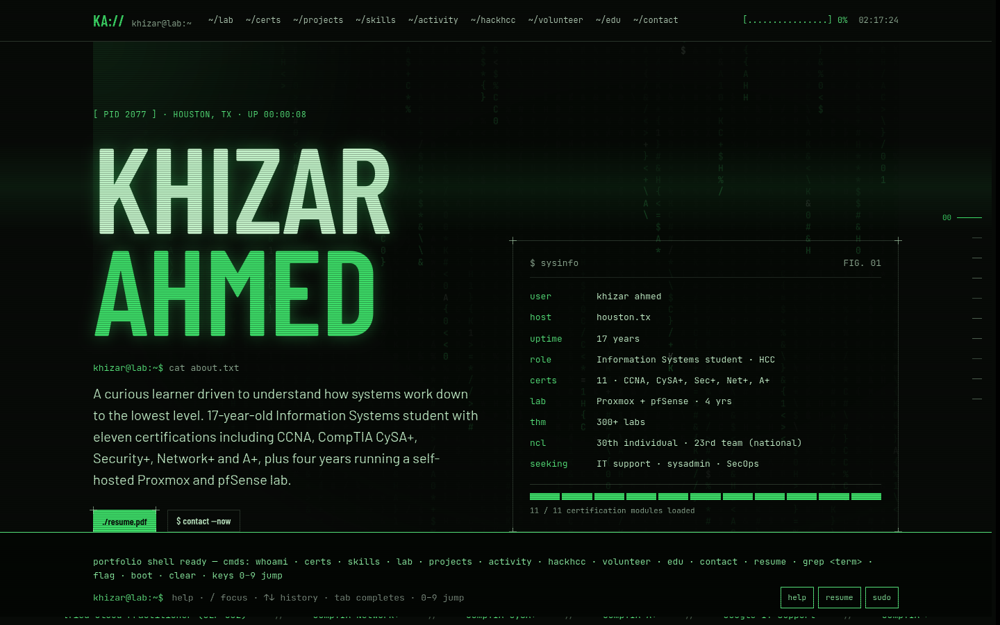

# Khizar Ahmed — Portfolio

**Live:** [khiz3r.me](https://khiz3r.me)

My personal portfolio and resume site, built as an old-school phosphor terminal. I'm an Information Systems student at Houston City College looking for an internship or entry-level role in IT support, systems administration, or security operations.



## What's on it

- **Home lab:** an interactive diagram of my Proxmox + pfSense lab. Hover or tap a node to see what it does.
- **Certifications:** eleven certs, including CCNA, CompTIA CySA+, Security+, Network+ and A+, shown as a boot log you can filter by vendor.
- **Projects:** the NASA pre-apprenticeship moon-base network and Wayne Finance (HackRice 2026), as draggable windows.
- **Skills, activities, HackHCC, volunteering, education and contact.**

## Things to try

- **Command bar** at the bottom: type `help`, `whoami`, `resume`, `grep <term>`, or a section name. `↑`/`↓` scrolls history, `Tab` completes, `/` focuses it.
- **Number keys `0`–`9`** jump between sections.
- **A hidden flag** is somewhere on the page. Submit it with `submit <flag>`.

The page respects `prefers-reduced-motion` and works on screens down to about 360px wide.

## Stack

- A single static page: `index.html` holds the template and logic, with `support.js` as the runtime.
- Styling is built on a design system bundle in `_ds/`, with its tokens overridden for the green-on-black theme.
- Fonts are Barlow, Barlow Condensed and JetBrains Mono from Google Fonts.
- It's hosted as static assets on Cloudflare Workers (see `wrangler.jsonc`).

## Run it locally

No build step. Serve the folder with any static file server:

```sh
python3 -m http.server 8080
```

Then open <http://localhost:8080>.

## Deploy

Cloudflare deploys the site automatically on every push to `main`. To deploy by hand instead:

```sh
npx wrangler deploy
```

`.assetsignore` keeps repo-only files, such as this README, `docs/` and `LICENSE`, out of the deployed site.

## License

[MIT](LICENSE). The code is free to reuse. The resume content and personal details are mine, so please don't present them as yours.
